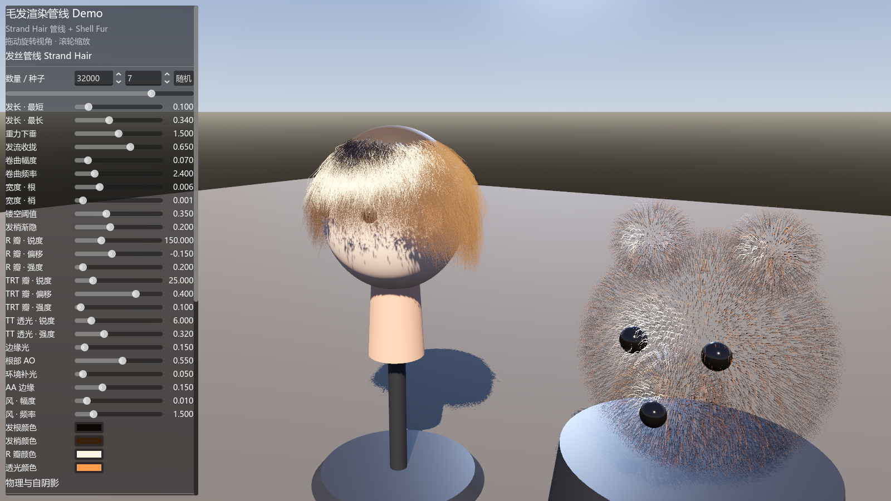
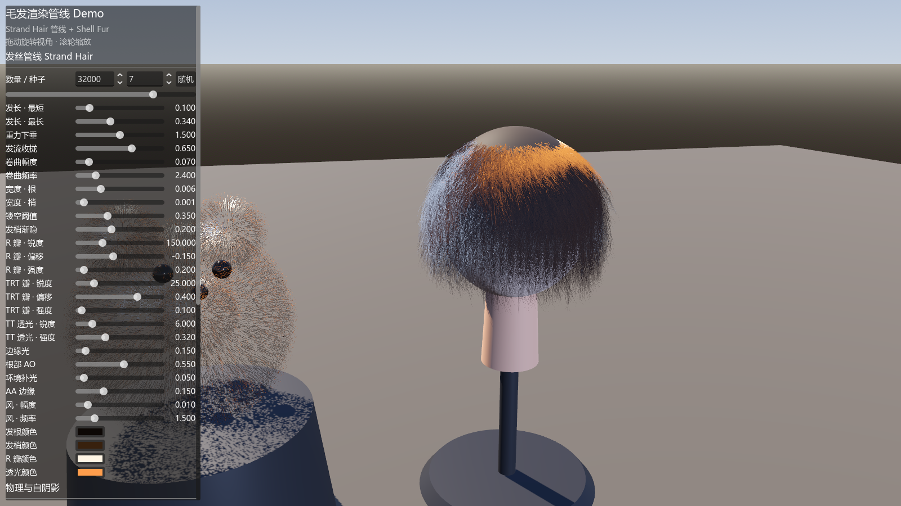
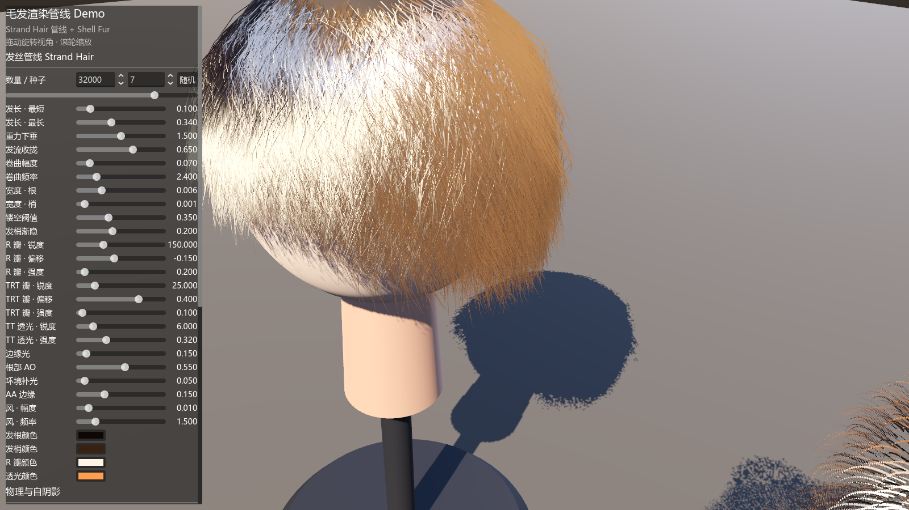
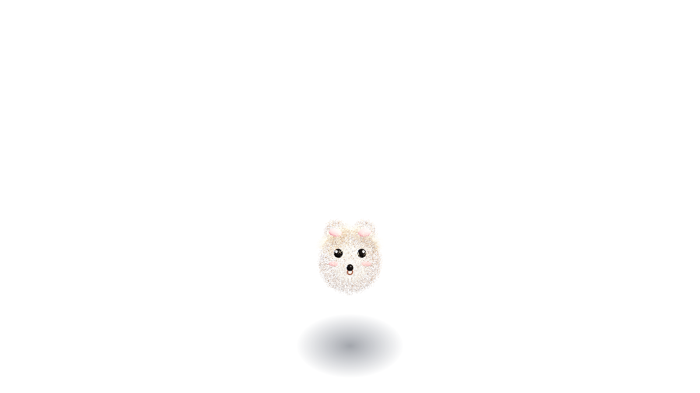

# Godot 毛发渲染管线 Demo

在 Godot 4.7（Forward+，已于 4.7.2 验证）里演示两套经典实时毛发渲染技术，附完整可调参数面板：

- **发丝管线（Strand Hair）** —— 半身像上的长发：CPU 生成发丝 → GPU 造型 → ribbon 展开 → Marschner 各向异性着色
- **外壳毛发（Shell Fur）** —— 右侧毛绒玩偶：球体层叠外壳 + 3D 噪声纤维镂空
- **桌面萌宠（Desktop Pet）** —— 把毛绒小熊做成透明置顶桌面宠物，支持拖拽/散步/蹦跳，
  头顶呆毛走 Verlet 物理；同一套场景代码自动适配移动端（触摸 + 画质降档 + Android 导出）

## 运行

1. 安装 [Godot 4.7+](https://godotengine.org/download)（需要 Forward+ 渲染器，即桌面版）。
2. 用 Godot 打开本目录（含 `project.godot`）：
   - **管线 Demo**：直接按 F5。
   - **桌面萌宠**：在编辑器里打开 `scenes/desktop_pet.tscn` 按 F6，
     或命令行 `godot --path . res://scenes/desktop_pet.tscn`。
3. Demo 操作：**左键拖动**旋转视角，**滚轮**缩放；左侧面板实时调参。
   萌宠操作：左键拖拽、右键菜单（切换物理/退出）、ESC 退出。

> 项目已开启 4× MSAA（发丝用 alpha scissor + alpha-to-coverage 镂空，MSAA 负责平滑边缘）。
> `project.godot` 里的 `window/size/transparent` 是给桌面萌宠的透明窗口用的，
> 对管线 Demo 无影响（它有天空背景填充）。







## 发丝管线各阶段

```
① CPU 生成（scripts/hair_strand_builder.gd）
   头皮采样（发际线 = 前额高/脑后低 + 低频噪声）
   每根发丝只烘焙: 根位置 / 生长方向 / 卷曲正交基 / (t, side, randA, randB)
                    + 最近引导丝索引与权重 (UV/UV2)
   → 默认 32,000 根 × 20 顶点，一次生成 < 100 ms，改种子/密度才需重建
        │
        ▼
② GPU 造型 + 展开（shaders/hair_shaping.gdshaderinc · vertex）
   程序化：沿头皮“下坡”方向 S 曲线梳理 + 重力下垂 (t²) + 螺旋卷曲 + 风摆
   物理混合：CPU Verlet 引导丝（hair_physics.gd，距离约束/形状回弹/头部碰撞）
   经 RGBA32F 数据纹理传入，发丝按最近引导丝位移跟随，头部球面碰撞兜底
   切线 = 轨迹解析导数 → 沿 切线×视线 展开成相机朝向 ribbon（根粗梢细）
        │
        ▼
③ GPU 着色（fragment + light）
   Marschner 三瓣各向异性高光：R 表面反射（锐利、近白）
   / TT 透射（背光门控，逆光时琥珀色辉光）/ TRT 内部反射（宽带、被发色染色）
   根→梢颜色渐变、发丝间颜色差异、根部 AO、切线菲涅尔边缘光
   横向 1-|side| 渐变 + alpha scissor + alpha-to-coverage 软边缘（深度写入正确，无需排序）
        │
        ▼
④ 引擎集成
   内置 shadow pass（顶点位移同样生效）→ 发丝投射并接收场景阴影
   DOM 自阴影（SubViewport 从主光方向捕捉头发不透明度/深度，light() 内按
   「体积前缘→本片元」深度比例指数衰减）→ 发丝互相遮挡，内部与发根变暗
   MSAA 4× + alpha-to-coverage 平滑镂空边缘；单 draw call，Forward+ 集群光照
```

## 外壳毛发（Shell Fur）

`scripts/fur_shell_builder.gd` 把玩偶球体沿法向复制成 36 层外壳合并为一个表面；
`shaders/fur_shells.gdshader` 顶点阶段挤出（带重力弯曲），片元阶段用 3D 网格哈希
抠出圆形纤维截面，逐层抬高镂空阈值让毛尖自然稀疏（同样使用 alpha-to-coverage
软边缘，覆盖坐标取纤维截面距离）。整只玩偶一次 draw call。

## 桌面萌宠（Desktop Pet）

`scenes/desktop_pet.tscn` 把毛绒小熊做成桌面宠物：

- **透明置顶窗口**：全屏无边框 + `window/size/transparent` 逐像素透明，
  通过 `DisplayServer.window_set_mouse_passthrough` 只保留萌宠周围的矩形接受鼠标，
  其余区域点击穿透到桌面（Windows/Linux）。
- **行为状态机**：待机（呼吸、随机眨眼、抖耳、蹦跳）→ 散步（沿屏幕底边、到边折返、
  走路弹跳）→ 拖拽（跟手）→ 松手落地。呆毛是发丝管线 + Verlet 引导丝，
  走路/拖拽/蹦跳时甩动回弹；毛皮有随时间轻摆的风。
- **完整头部**：博美式双层毛色（焦糖身体 + 奶油口鼻/脸颊毛）、猫式 ω 嘴、
  粉色内耳、带高光的黑豆眼、腮红。
- **会张合的嘴**：口腔与舌头随状态缩放——蹦跳/下落张大（惊讶）、拖拽半张、
  散步微喘、待机闭合 ω；ω 弧同步外滑充当上唇。
- **毛发遮罩（fur mask）**：五官周围球域内的毛自动变短、变细、变稀
  （COLOR.g 烘焙遮罩系数，着色器里缩毛 + 降低 alpha），避免长毛糊住脸——
  真实动物口鼻部/眼周的毛就远比身体短。
- **接触阴影**：径向渐变公告板贴片跟随脚底。

### 移动端适配

同一场景按运行环境自动切换（`OS.has_feature("mobile")` 或环境变量 `PET_FORCE_MOBILE=1`）：

| 项目 | 桌面 | 移动端 |
| --- | --- | --- |
| 窗口 | 全屏透明置顶 + 点击穿透 | 普通全屏 + 深色底色 |
| 交互 | 鼠标拖拽/右键菜单 | 触摸拖拽（Godot 默认触摸模拟鼠标） |
| 呆毛发丝 | 4,000 根（8 万顶点） | 1,200 根（2.4 万顶点） |
| 外壳层数 | 36 层 | 18 层 |
| 引导丝 | 96 根 | 48 根 |

### 导出

`export_presets.cfg` 已带 **Windows Desktop** 与 **Android** 两个预设：

```bash
# Windows（本机可直接导出）
godot --headless --path . --export-release "Windows Desktop" build/FurPet.exe
# Android（需先在编辑器里安装 Android 构建模板并配置 SDK/调试密钥库）
godot --headless --path . --export-release "Android" build/FurPet.apk
```

Android 预设：包名 `com.furpet.demo`、arm64-v8a、竖屏沉浸模式。桌面萌宠在手机上
就是一个全屏触摸宠物应用（桌面宠物依赖的透明穿透窗口是桌面系统特性，手机上没有）。

### 萌宠测试辅助（环境变量）

`PET_SHOT=<png>`（截图并退出，打印 alpha 采样与位置）、`PET_SHOT_DELAY=秒`、
`PET_FORCE_MOBILE=1`、`PET_FORCE_WALK=1`（强制散步）、`PET_SIZE=0.42`（占屏比例）。

## 文件结构

```
project.godot                   工程配置（Forward+，4× MSAA，透明窗口）
scenes/main.tscn                管线 Demo 入口
scenes/desktop_pet.tscn         桌面萌宠入口（编辑器中 F6 运行）
scripts/main.gd                 场景搭建 / 参数面板 / DOM 捕捉视口 / 自动截图
scripts/desktop_pet.gd          桌面萌宠：窗口/行为状态机/拖拽/移动端适配
scripts/hair_strand_builder.gd  发丝管线 CPU 阶段（含毛簇采样与引导丝最近邻匹配）
scripts/hair_physics.gd         Verlet 引导丝模拟（距离约束/形状回弹/碰撞）
scripts/fur_shell_builder.gd    外壳毛发 CPU 阶段
scripts/orbit_camera.gd         轨道相机
shaders/hair_strands.gdshader   发丝着色（Marschner 三瓣 / DOM 自阴影 / A2C）
shaders/hair_shaping.gdshaderinc 造型共享代码（主渲染与 DOM 捕捉保持一致）
shaders/hair_dom.gdshaderinc    DOM 自阴影采样
shaders/hair_opacity_capture.gdshader DOM 捕捉通道（加法混合累计不透明度/深度）
shaders/fur_shells.gdshader     外壳毛发 挤出/镂空/着色
export_presets.cfg              Windows / Android 导出预设
```

## 自动化截图（CI / 回归测试用）

```bash
HAIR_DEMO_SHOT=/tmp/front.png  HAIR_DEMO_YAW=35  godot --path . --quit-after 600
HAIR_DEMO_SHOT=/tmp/close.png  HAIR_DEMO_DIST=1.5 godot --path . --quit-after 600
```

支持的环境变量：`HAIR_DEMO_SHOT`（截图路径，设置后截图即退出）、
`HAIR_DEMO_SHOT_DELAY`（默认 1.8 秒）、`HAIR_DEMO_YAW / PITCH / DIST`（相机视角）、
`HAIR_DEMO_TURNTABLE=1`（开启转台，配合物理观察甩动）、
`HAIR_DEMO_SET`（覆盖发丝材质参数，如 `"spec1_strength=0.3;droop=2"`，调试用）。

## 常用参数建议

| 想要的效果 | 调整 |
| --- | --- |
| 更浓密 | 「数量 / 种子」数量上调，或「宽度 · 根」加大 |
| 更柔顺 | 卷曲幅度/频率调 0，「发流收拢」加大 |
| 爆炸卷发 | 卷曲幅度 0.25+、频率 5+，重力下垂调小 |
| 玻璃丝高光 | R 瓣锐度 150+、强度 0.3~0.5（强度过高配合主光会过曝发白） |
| 逆光辉光 | TT 透光强度加大，从背光角度观察（可开转台旋转） |
| 头发甩动 | 「物理模拟」拉满 + 勾选转台；「形状刚度」越低甩得越远 |
| 发丝间体积感 | 「自阴影强度」加大（过大会整体发黑） |
| 性能不足 | 数量降到 8000–15000，引导丝减到 200（顶点数与发丝数线性相关） |

## 已知取舍 / 可扩展方向

- 透明处理用 alpha scissor + alpha-to-coverage（配合 MSAA）而非逐层混合：换取正确的
  深度写入，避免万级发丝的排序问题，同时获得半透明的软边缘。
- 物理是**引导丝方案**：CPU 模拟几百根引导丝（Verlet + 距离约束 + 形状回弹 + 球体
  碰撞），顶点着色器把稠密发丝插值到引导丝上。相比逐丝 compute 模拟便宜一个量级；
  升级方向是 compute shader 全量模拟 + 更精细的碰撞体。
- DOM 自阴影是**单层简化版**（一次捕捉累计不透明度 + α 加权前后缘深度，线性密度
  假设）；更完整的是多层 Deep Opacity Maps / Moment Shadow Maps。
- 高光为 **Marschner 简化版**（KK 式 sin 幂近似三瓣 + 背光门控）；更物理的做法是
  完整 Marschner（吸收系数/Melanin 模型 + 电介质菲涅尔）。
